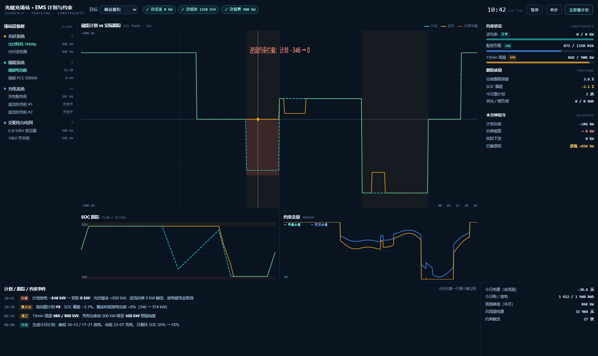

# 光储充场站 EMS：计划 · 跟踪 · 约束 改造设计稿

> 状态：**已实施（P1–P3）**，P4 文案仍在打磨
> 实施日期：2026-11-19
> 目标页面：`energy/pv-storage-charging/index.html`
> 回归测试：`tests/pv-storage-charging.test.js`
>
> 

---

## 0. 一句话方案

把现在"五个互斥策略按钮"的即时决策，改成**日前计划 → 实时跟踪 → 约束校核 → 滚动重计划**的闭环：

- **目标**（可切换）：峰谷套利 / 消峰填谷 / 需量最小 / 自发自用最大
- **约束**（常开，可开关演示）：防逆流 / 防超容 / 防超需
- **计划**：每天生成 1440 点 PCS 功率曲线 + SOC 轨迹，首尾闭环
- **跟踪**：实际 vs 计划，给出误差与偏差
- **重计划**：每 15 min 或偏差超阈值时重算剩余时段

---

## 1. 现状与问题

| 现状 | 问题 |
|---|---|
| 5 个策略按钮互斥 | 现实里"防逆流"是约束、永远生效，不可能与"峰谷套利"互斥 |
| 每 200 ms 即时决策，无长周期计划 | 没有"计划"，也就没有"跟踪"，看不到 EMS 真正的工作方式 |
| 防超容 / 防超需 完全没建模 | 充电站最贵的两项（配变容量、月需量）没有体现 |
| 峰段放电不看光伏富余 | 演示出"边放电边大功率上网"，与文案矛盾（已复现：10:01 PCS −342 kW、电网 −850 kW） |

---

## 2. 目标架构

```
              ┌───────────── 每 15 min ─────────────┐
              ▼                                     │
  ┌────────────────────┐   ┌──────────────────┐   ┌─┴─────────────────┐
  │ ① 预测              │──▶│ ② 计划生成        │──▶│ ④ 滚动重计划       │
  │ 日照 / 充电需求      │   │ 24h PCS+SOC 曲线  │   │ 剩余时段重算        │
  └────────────────────┘   └──────────────────┘   └───────────────────┘
                                     │  P_plan(t), SOC_plan(t)
                                     ▼
  ┌────────────────────┐   ┌──────────────────┐   ┌───────────────────┐
  │ 实际输入            │──▶│ ③ 跟踪 + 约束校核 │──▶│ 下发 PCS/光伏/充电 │
  │ 日照·车流·电网      │   │ 逆流>超容>超需    │   │ + 事件日志          │
  └────────────────────┘   └──────────────────┘   └───────────────────┘
```

三个时间尺度：

| 层 | 周期 | 内容 |
|---|---|---|
| 日前计划 | 每 24 h（或手动） | 生成 24 h 功率/SOC 曲线，做计划级约束预校核 |
| 滚动重计划 | 15 min 或事件触发 | 用实际 SOC 修正剩余时段 |
| 实时执行 | 1 min 仿真步（现实 1 s） | 跟踪 + 约束裁剪 + 指标累计 |

---

## 3. 数据模型

```js
const CFG = {
  pvKwp: 1000, pcsKw: 500, bessKwh: 1000,
  etaCh: 0.95, etaDis: 0.95, socMin: 0.10, socMax: 0.95,
  chargers: 10, chargerKw: 120,
  kva: 1250, pf: 0.98,     // 配变容量 / 功率因数
  demandKw: 900,           // 申报需量（待定，见第 12 节）
  dtMin: 1
};
const TARIFF = { valley: 0.30, flat: 0.65, peak: 1.05, feedIn: 0.35, demandPrice: 38 };
// demandPrice: 元/kW·月，用于把需量折算成当日费用

const LIMITS = {
  reverseKw: 0,        // 0 = 全部自发自用；null = 全额上网；数值 = 限值
  kva: 1250,
  demandKw: 900
};

const OBJECTIVES = ['tou', 'peakShaving', 'demandMin', 'selfConsume'];
```

状态：

```js
const st = {
  t: 0,                       // 0..1439
  soc: 0.55,                  // 实际 SOC
  objective: 'tou',
  limits: { ...LIMITS },
  plan: { pcs: Float32Array(1440), soc: Float32Array(1440), madeAt: 0, objective: 'tou' },
  actual: { pv: 0, load: 0, pcs: 0, grid: 0 },
  demandWin: [],              // 最近 15 个实际购电功率（kW）
  metrics: { cost: 0, eIn: 0, eOut: 0, curtailed: 0, shed: 0,
             trackMae: 0, trackN: 0, socDevMax: 0, intercepts: 0, replans: 0 },
  log: [], events: []
};
```

---

## 4. 仿真内核接口

保持在 `<script id="sim-core">` 内，纯 JS 无 DOM，便于 `vm` 直接测试。

```js
// ① 预测：计划用；与实际值分离，才能产生"跟踪误差"
forecast(m)          → { sun, load }        // 带确定性种子噪声
// ② 计划：生成整日曲线
makePlan(st, from, objective, limits) → plan
// ③ 执行一步
stepSim(st)          → snap
// ④ 约束裁剪：目标 → 可行
enforce(st, cmdKw)   → { pcs, curtailed, shed, reasons[] }
// ⑤ 重计划
replan(st, reason)   → plan
// ⑥ 指标
metricsOf(st)        → { mae, socDev, interceptKwh, ... }
```

`stepSim` 主流程（替换现有 619–740 行）：

```js
function stepSim(st){
  const dtH = CFG.dtMin / 60;

  // 1. 实际环境（不可预知的那一份）
  const a = actualAt(st.t);                 // { sun, load }
  let pvAvail = CFG.pvKwp * a.sun;

  // 2. 取计划值
  const pPlan = st.plan.pcs[st.t];

  // 3. 目标 → 约束裁剪
  const r = enforce(st, pPlan);

  // 4. 功率平衡与 SOC
  let pv = pvAvail, load = a.load, pcs = r.pcs;
  let grid = load + pcs - pv;
  // （逆流/超容/超需已在 enforce 内处理，这里只做最终平衡与弃光/切负荷）

  // 5. 状态更新、指标累计、日志
  updateSoc(st, pcs, dtH);
  pushDemandWin(st, grid);
  accMetrics(st, { pv, load, pcs, grid, curtailed: r.curtailed, shed: r.shed });

  // 6. 重计划判定
  if (st.t % 15 === 0 || Math.abs(st.soc - st.plan.soc[st.t]) > 0.03 ||
      st.events.some(pending)) replan(st, 'roll');

  // 7. 时间推进
  st.t = (st.t + 1) % 1440;
  return st.snap;
}
```

---

## 5. 约束引擎

### 5.1 三级顺序与冲突裁决

| 冲突 | 裁决 | 手段 |
|---|---|---|
| 逆流 vs 超需（既要放电又不能反送） | **逆流优先** | 放电归零，缺口改用"限充电桩"补 |
| 超容 vs 套利（想满功率充电） | **超容优先** | 充电降功率 |
| 超需 vs 套利（谷段想满充） | **超需优先** | 按 15 min 窗口反算允许功率 |
| SOC 上限 vs 计划充电 | SOC 优先 | 降功率 / 弃光 |

### 5.2 实现

```js
function enforce(st, want){
  const reasons = [];
  let pcs = clamp(want, -CFG.pcsKw, CFG.pcsKw);
  let curtailed = 0, shed = 0;
  const pv = st.actual.pv, load = st.actual.load;
  let grid = load + pcs - pv;

  // ① 逆流：不允许反送
  if (st.limits.reverseKw != null && grid < -st.limits.reverseKw){
    const over = -st.limits.reverseKw - grid;          // 需要多消耗的功率
    const room = maxCharge(st) - pcs;                   // 还能多充多少
    const add = Math.min(over, Math.max(0, room));
    pcs += add;
    if (over - add > 0.5){ curtailed = Math.min(over - add, pv); }
    reasons.push({ code: 'reverse', over, added: add, curtailed });
    grid = load + pcs - pv;
  }

  // ② 超容：视在功率（简化为 |P|/pf）
  const sKva = Math.abs(grid) / CFG.pf;
  if (sKva > CFG.kva){
    const over = grid - CFG.kva * CFG.pf;               // 超出部分
    // 先放电（最多到 maxDis），再切负荷
    ...
    reasons.push({ code: 'kva', over });
  }

  // ③ 超需：15 min 滑动平均预判
  const avg = (sumWin(st) - oldest + grid) / 15;
  if (avg > CFG.demandKw){
    const allow = CFG.demandKw * 15 - (sumWin(st) - oldest);  // 本分钟允许的功率
    pcs += (allow - grid);                                  // 减充电/增放电
    reasons.push({ code: 'demand', allow, avg });
  }

  // ④ SOC / 功率最终 clamp
  ...
  return { pcs, curtailed, shed, reasons };
}
```

### 5.3 与现有代码的对应

现有 662–683 行的两段 `if(grid < -expLimit)` / `if(grid > impLimit)` 就是 ① 和 ② 的雏形，可直接演进为 `enforce()`，**不必重写**。

---

## 6. 计划生成

### 6.1 规则法（默认，透明好讲）

给定节点目标 SOC，逐段反算功率：

| 时刻 | 时段 | 目标 SOC | 动作 |
|---|---|---|---|
| 00:00 | — | 0.55 | 起点 |
| 07:00 | 谷段 | 0.90 | 450 kW 充电 |
| 10:00 | 平段 | 0.90 | 保持 |
| 12:00 | 峰段 | 0.30 | 放电（≈ 450 kW） |
| 17:00 | 平段 | 0.85 | 光伏富余回充 |
| 21:00 | 峰段 | 0.25 | 放电（≈ 500 kW） |
| 24:00 | 谷段 | 0.55 | 回充闭环 |

```js
function makePlan(st, from, objective, limits){
  const pcs = new Float32Array(1440), soc = new Float32Array(1440);
  let s = st.soc;
  const nodes = NODES[objective];         // [[t, socTarget], ...]
  for (let m = from; m < 1440; m++){
    const target = interpNodes(nodes, m);
    const need = (target - s) * CFG.bessKwh;             // kWh
    let p = need / (1/60) / (need > 0 ? CFG.etaCh : 1/CFG.etaDis);
    p = clamp(p, -CFG.pcsKw, CFG.pcsKw);
    pcs[m] = p;
    soc[m] = s;
    s += (p > 0 ? p * CFG.etaCh : p / CFG.etaDis) / 60 / CFG.bessKwh;
    s = clamp(s, CFG.socMin, CFG.socMax);
  }
  // 计划级预校核：用预测值跑一遍 enforce，剔除不可行点
  return { pcs, soc, from, objective, madeAt: st.t };
}
```

### 6.2 优化法（可选，进阶）

24 h 线性规划，目标：

```
min  Σ [ price(t) · P_grid⁺(t) − feedIn · P_grid⁻(t) ] · Δt
   + demandPrice/30 · max_t( 15min 均值 P_grid⁺ )
```

约束：功率平衡、PCS 上下限、SOC 动态与边界、逆流、配变容量、需量。
教学上建议**两条路都保留**：规则法讲"人怎么想"，优化法讲"最优解长什么样"，并对比两者电费差。

### 6.3 预测误差（关键）

如果计划和实际用同一套数据，跟踪误差恒为 0，演示就失去意义。必须分离：

```js
function forecast(m){ return { sun: sunAt(m) * (1 + noise(m, 0.08)), load: loadDemand(m) * (1 + noise(m, 0.15)) }; }
function actualAt(m){ ... 真实曲线，含场景扰动 ... }
function noise(m, amp){ /* 种子化 LCG，保证测试可复现 */ }
```

---

## 7. 跟踪与重计划

### 7.1 指标

| 指标 | 定义 | 好/坏参考 |
|---|---|---|
| 功率跟踪误差 | `Σ|pcs−plan| / Σ max(1,|plan|)` | < 5% 良好 |
| SOC 偏差 | `soc_actual − soc_plan` | ±2% 内正常 |
| 约束拦截电量 | 被裁剪掉的 kWh | 取决于策略激进程度 |
| 重计划次数 | 每日 | 3–10 次正常 |

### 7.2 触发条件

1. 每 15 min 定时；
2. `|SOC 偏差| > 3%`；
3. 事件：天气突变、电网告警、手动"立即重计划"。

重计划只重算 `[now, 24:00]`，并把首尾 SOC 闭环约束改为"剩余时段内回到目标 SOC"。

---

## 8. 页面结构

见 `docs/ems-schedule-wireframe.png`。相对现有页面的改动：

| 区域 | 现状 | 改造后 |
|---|---|---|
| 顶栏 | 策略 pill | 目标下拉 + 三个约束 chip + 「立即重计划」 |
| 左栏 | 设备树 | 保留，选中设备显示该设备的计划/实际 |
| 中栏上 | 3D 场站（约占 2/3） | 保留为「场站视图」，新增「计划视图」Tab（默认） |
| 中栏下 | 5 个迷你图 | 2 个：计划 vs 实际（功率）、SOC 跟踪；+ 约束余量 |
| 右栏 | 策略按钮 + 场景 | 约束仪表（3 个）+ 跟踪质量 + 本分钟指令（计划/裁剪/实际/原因） |
| 底栏 | 决策日志 | 计划/跟踪/约束事件流，**每条都回答"为什么偏离计划"** |
| 场景按钮 | 8 个 | 保留，但改为"注入扰动"（云遮、车流、电网限功率、断电） |

交互要点：

1. 拖动时间轴可回看任意分钟的计划/实际（只读，不改变状态）；
2. 点击日志行 → 弹窗展示"计划值 → 约束校核 → 下发值"的完整算式；
3. 约束 chip 可点击开关，用于演示"同一目标、不同约束"的对照。

---

## 9. 三个演示脚本

### S1 理想日（建立基线）

- 设置：晴天、预测误差小、三条约束全开
- 预期：跟踪误差 < 3%，SOC 偏差 < 1%，约束 0 次拦截
- 讲解：**计划是可行的，执行是忠实的**

### S2 超需打脸（约束拦截）

- 操作：夜间 23:00 起谷段满功率充电 + 夜间负荷偏高
- 预期：15 min 需量逼近 900 kW → 充电功率被压到 ~420 kW；月需量电费变化可量化
  （`(950−900) × 38 ≈ 1 900 元/月`）
- 讲解：**目标想多充，约束不让；代价是月电费，不是当天电费**

### S3 跟踪失效与重计划（闭环韧性）

- 操作：12:00 后光伏骤降 60%，同时充电车辆集中到达
- 预期：逆流约束解除但 SOC 开始落后计划 → 10:30 触发重计划，剩余时段功率 +8%
- 讲解：**计划一定会失效，关键是多久发现、怎么修正**

---

## 10. 验收标准与测试

新增断言（放在 `tests/pv-storage-charging.test.js`，沿用现有风格）：

```js
// 不变式：任意目标 × 任意约束组合 × 任意场景
for (const objective of OBJECTIVES)
for (const reverse of [0, null])
for (const sc of ['none', 'cloud', 'surge', 'outage']) {
  const st = SIMCORE.createSim({ objective, limits: { reverseKw: reverse } });
  for (let i = 0; i < 1440; i++) {
    const x = SIMCORE.stepSim(st);
    if (reverse === 0) assert.ok(x.grid >= -0.5, '防逆流：不得反送');
    assert.ok(Math.abs(x.grid) / 0.98 <= 1250 + 1, '防超容');
    assert.ok(SIMCORE.demand15(st) <= 900 + 1, '防超需');
    assert.ok(x.soc >= 0.1 - 1e-9 && x.soc <= 0.95 + 1e-9, 'SOC 边界');
  }
  const p = st.plan;
  assert.ok(Math.abs(p.soc[1439] - p.soc[0]) < 0.01, '计划首尾 SOC 闭环');
}
// 可解释性
assert.ok(st.log.every(e => !e.reasons.length || e.reasons[0].code), '拦截必须有原因码');
```

矩阵规模：4 目标 × 2 逆流 × 4 场景 × 1440 步 ≈ 4.6 万次迭代，秒级完成。

---

## 11. 实施分期

| 期 | 内容 | 文件 | 估计 |
|---|---|---|---|
| P1 | `forecast / makePlan / enforce / replan / metrics` | `sim-core` 段（410–793 行） | ~260 行，2 h |
| P2 | 计划视图、约束仪表、日志改造、目标/约束控件 | UI 段（1608–2183 行） | ~200 行，2 h |
| P3 | 不变式测试 + 场景测试 | `tests/pv-storage-charging.test.js` | ~90 行，1 h |
| P4 | 文案、讲解浮层、README 更新 | 页面 + README | ~1 h |

兼容性：

- 现有 5 个按钮 → 4 个目标 + `manual`（开环模式）；
- 现有 `mods.importLimit / exportLimit` 直接升级为 `limits`；
- 测试仍是"单文件、无依赖、`node xxx.test.js` 可跑"。

---

## 12. 待你拍板

1. **申报需量取多少？** 我按 1250 kVA × 0.72 假设 900 kW，实际应由用户报装决定；
2. **是否允许上网？** 建议默认 `reverseKw = 0`（多数省份用户侧储能不允许倒送套利），演示"全额上网"时再放开；
3. **上网电价**改固定 0.35 元/kWh？现在按分时电价 × 0.35，峰段会卖到 0.37 元，不符合实际；
4. **3D 场景保留吗？** 建议保留为「场站视图」Tab，默认展示计划视图（信息密度更高）；
5. **计划生成要不要做优化法（LP）？** 规则法已够讲清闭环，LP 是加分项但代码量翻倍。

---

## 13. 实施记录（2026-11-19）

实际落地与本文设计的差异，按"够用且可验证"取舍：

| 项 | 设计 | 实施 | 原因 |
|---|---|---|---|
| 计划生成 | 节点目标 SOC 曲线 | 规则目标 + 逐分钟可行化 + 23:00 收尾闭环 | 复用原有策略意图，日循环不漂移 |
| 目标数量 | 4 目标 + 手动 | 同（峰谷套利 / 消峰填谷 / 需量最小 / 自发自用最大 / 手动） | — |
| 约束 | 逆流 / 超容 / 超需 | 同，三个 chip 可独立开关 | 演示"同一目标、不同约束" |
| 需量 | 待定 | 900 kW（1250 kVA × 0.72） | 待用户按实际报装调整 |
| 上网电价 | 建议固定 0.35 | 已改为固定 0.35 元/kWh | 原来按分时电价 × 0.35，峰段会卖到 0.37 |
| 防逆流默认 | 建议开启 | 默认 
everseKw = 0（全部自发自用） | 多数省份用户侧储能不允许倒送套利 |
| 优化法（LP） | 可选 | 未做 | 规则法已能讲清闭环，LP 留作后续 |
| 3D 场景 | 保留为 Tab | 保留原样（未改动 3D 代码） | 只换数据源，降低回归风险 |

关键行为（已由测试锁定）：

1. 任意目标 × 任意约束组合 × 六种场景下，功率平衡闭合、PCS ≤ 500 kW、SOC ∈ [10%, 95%]、配变 ≤ 1250 kVA、15 min 需量 ≤ 900 kW；
2. 防逆流开启时全天上网电量为 0，关闭后 > 100 kWh，且弃光量下降；
3. **"边放电边倒送"零发生**（旧版本的 bug 已固化为回归用例）；
4. 断电时进线功率为 0，储能支撑不足则限负荷；
5. 计划首尾 SOC 闭环误差 < 2%。
